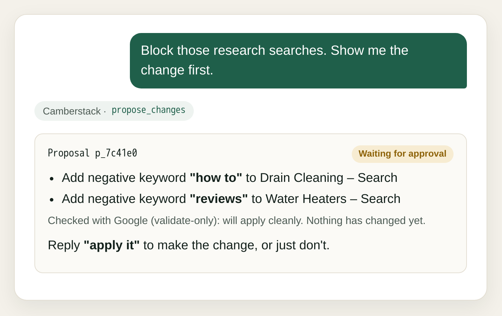

# Camberstack: Google Ads, Search Console, GA4, Merchant Center and Tag Manager MCP server for Claude and ChatGPT

Connect **Google Ads, Search Console (GSC), Google Analytics 4 (GA4), Merchant Center (GMC) and Tag Manager (GTM)** to Claude,
ChatGPT, Cursor or any MCP client with one Google sign-in, and use them together: the searches you pay for that already rank,
whether ad clicks convert on the landing page, which disapproved products were earning in Shopping, whether the tags behind
your conversions fire where they should. Your AI reads with
read-only tools and can propose changes, from negative keywords to whole Search, Performance Max, Display and
YouTube campaigns, GA4 key events, Merchant Center product fixes and Tag Manager tags. **Nothing changes until you approve a specific
proposal**, and risky changes and deletions Google can't reverse are flagged first. No developer token, API keys
or Google Cloud project. A demo account lets anyone try every tool first.

Demo account 000-000-0001: sample data for a fictional plumbing business.

Hosted: **https://camberstack.io/mcp**. Free: every tool and unlimited changes on 1 account, with one switch a month;
from November 15, one Google service at a time. Plus $7/mo: all five services on 1 account. Pro $15/mo: up to 5
accounts. Agency $49/mo: up to 25.

**Setup guides, with screenshots and troubleshooting:** [Connect Google Ads to Claude](https://camberstack.io/google-ads-claude) ·
[Connect Google Ads to ChatGPT](https://camberstack.io/google-ads-chatgpt) · [every tool](https://camberstack.io/tools) ·
[Cursor, VS Code and others](https://camberstack.io/#setup)

## Ask it things like

- "Which searches am I paying for that already rank in the top 3 organically?"
- "Which landing pages get ad clicks but no conversions?"
- "Why were my best-selling products disapproved, and what were they earning in Shopping ads?"
- "Find search terms wasting money this month and propose negative keywords."
- "Build a Search campaign for our new service page, paused, with 3 ad groups."
- "Is my Google Ads conversion tag set up right in Tag Manager?"
- "Which Search Console queries on page 2 would be worth the most clicks if they moved up?"

## What it does

- **[Google Ads](https://camberstack.io/):** account overview with what needs attention, any read-only GAQL query, Keyword Planner ideas and
  metrics, and proposals that add negatives, change budgets, bids and targeting, edit ads, or build whole Search,
  Performance Max, Display and YouTube (Demand Gen) campaigns, always created paused.
- **[Search Console](https://camberstack.io/google-search-console-mcp):** site summary, performance by query, page, country or device, rising and falling queries,
  page-2 opportunities, URL inspection, sitemaps.
- **[GA4](https://camberstack.io/google-analytics-mcp):** landing-page and custom reports, properties and streams, key events and Google Ads links.
- **[Merchant Center](https://camberstack.io/google-merchant-center-mcp):** product issues, disapproved products joined with what they earned in Shopping ads, and
  product fixes as overrides that never touch your feed.
- **[Tag Manager](https://camberstack.io/google-tag-manager-mcp):** containers, tags and triggers with tracking problems flagged (a conversion tag on every page,
  no Conversion Linker, retired Universal Analytics), and proposals that add, pause or delete tags and publish.
- **Across them:** searches you pay for that already rank organically, and landing-page speed from real Chrome users.

Every change is a proposal: Camberstack checks it against the live account, dry-runs it with Google where it can,
and shows a plain-English summary. Risky changes are flagged with ⚠, and nothing is applied until you approve.
Full tool reference: [camberstack.io/tools](https://camberstack.io/tools).

## Security and sign-in

You sign in with Google and grant only the services you want: Google Ads, Search Console, Analytics, Merchant
Center or Tag Manager, each addable later from a one-click link. Your Google token is stored encrypted (AES-256-GCM) and never
leaves the server; your AI app gets Camberstack's own tokens, stored only as hashes. Disconnecting revokes
Google access and deletes the stored credentials.

Running it yourself, environment variables and implementation notes: [docs/INTERNALS.md](docs/INTERNALS.md).

## License

MIT
